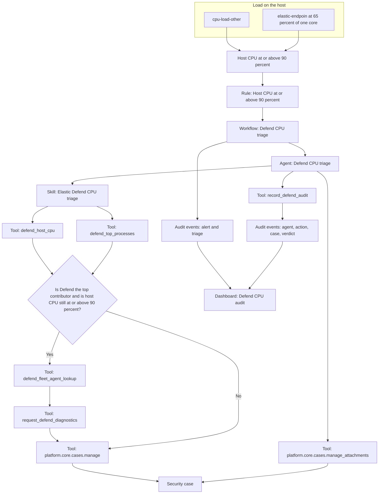

# How to run the Elastic Defend CPU workflow

This repository shows Agent Builder, tools, a skill, and workflows around one problem: a host sits near 90% CPU and someone needs to know whether Elastic Defend is the cause.

A host CPU alert starts an agent. The agent decides whether Defend is the top contributor. Only in that case does it request a Fleet diagnostics bundle. Either way it opens one Security case.

CPU in the detection rule is a fraction: **0.9 is 90%**.



## What is in the repository

| Path | What it is |
| --- | --- |
| `security/defend-host-cpu-90.json` | Detection rule: host CPU at or above 90% |
| `alerting/defend-host-cpu-90.json` | Same condition as a Kibana alerting rule. Leave it disabled in a Security project. |
| `alerting/action-policy.json` | Action wiring for that rule |
| `dashboards/elastic-agent-host-cpu.json` | Host and process CPU |
| `dashboards/defend-cpu-audit.json` | Audit trail from alert to verdict |
| `agent-builder/` | Agent, skill, and ES\|QL tools |
| `workflows/` | Triage, Fleet diagnostics, and audit workflows |
| `audit/` | Mapping for the `sibs-defend-audit` index |
| `runbooks/` | Security runbook content for the guide agent |
| `scripts/` | SSH helpers that put CPU load on the agent host |

## Objects in Kibana

| What | Where | Name |
| --- | --- | --- |
| Rule | Security → Rules | Host CPU at or above 90 percent |
| CPU dashboard | Dashboards | Elastic Agent host CPU |
| Audit dashboard | Dashboards | Defend CPU audit |
| Agent | Agent Builder | Defend CPU triage |
| Skill | Agent Builder | Elastic Defend CPU triage |
| Triage workflow | Workflows | Defend CPU triage |
| Diagnostics workflow | Workflows | Request Elastic Agent diagnostics |
| Audit workflow | Workflows | Record Defend audit |

The rule checks **every minute** and looks at the **last 20 minutes**. On the lab host, metrics take about **7 minutes** to reach Elasticsearch. The alert appears when the spike is visible inside that 20-minute window, not in the first minute.

The same host does not alert again for **30 minutes**. Wait that long between scenarios, or the second load will not open another case.

Leave the Universal Alerting copy of the rule disabled. In a Security project it is hidden, and enabling it would fire the same workflow twice.

## Before the session

```bash
cp .env.example .env
```

Set the agent host and the SSH key in `.env`. Do not commit that file.

```bash
AGENT_HOST=<agent-host>
AGENT_USER=ubuntu
AGENT_SSH_KEY=/path/to/private-key
```

`KIBANA_URL`, `ELASTICSEARCH_URL`, and `ELASTICSEARCH_API_KEY` are for the Elastic project you import these objects into. The API key stays in `.env`.

Turn on the rule **Host CPU at or above 90 percent**. Open **Elastic Agent host CPU** in another tab (last 30 minutes, refresh every 10 seconds).

## CPU on the remote host

From the repository, without opening a shell first:

```bash
scripts/remote-shell.sh top
scripts/remote-shell.sh 'ps -eo pid,pcpu,comm --sort=-pcpu'
```

`top` SSHs to `AGENT_HOST` and prints host CPU over the last second, plus the processes using it. `ps` lists pid, `%CPU`, and the process name, busiest first.

`top` and `ps` treat 100% as **one core**. On a 2-core machine, a process at 100% is half of the host. The detection rule uses host CPU.

## What the agent does

When the alert fires, **Defend CPU triage** calls the agent of the same name. The skill:

1. Reads the host from the alert.
2. Reads host CPU over the last 15 minutes.
3. Sums CPU per process. The largest sum is the candidate.
4. On Linux, Elastic Defend is `elastic-endpoin` (`elastic-endpoint` truncated to 15 characters). `elastic-endpoint.exe` also counts.
5. `elastic-agent` and `elastic-otel-co` are **not** the EDR.
6. Only when the host is still at 0.9 or above **and** Defend has the largest sum does it look up `agent.id` and request Fleet diagnostics with extra CPU metrics.
7. Opens **one** Security case (`owner` `securitySolution`). The description is Markdown: Decision, Host, Processes, and Diagnostics.

It does not open an Elastic Support ticket. The case and the diagnostics request are the package a person uses to open that ticket.

## Audit

Each stage writes a document to `sibs-defend-audit`. The workflow writes **alert** and **triage** before it calls the agent. The agent writes **agent** (the decision), **action** (diagnostics requested or not), **case**, and **verdict**.

The Status column uses the state of each stage: alert **triggered** or **not triggered**, triage and action **done** or **not done**, case **Open** or empty, verdict **true positive** or **not confirmed**. Action stays **not done** and counts 0 until diagnostics are requested. The Cases panel lists Security cases from the audit index and says whether the cause is Elastic Defend. The Open cases link in the saved dashboard is the relative path `/app/security/cases`, so it stays on whichever Kibana you import it into.

**Defend CPU audit** (last 24 hours, refresh every 10 seconds) shows that trail: six stages, totals, verdicts, cause, and the log. It fills on the next alert. Until then the panels say there are no events in the range.

## Scenario 1: host at 90%, not the EDR

Defend is not the busiest process. A case should open and diagnostics should **not** be requested.

```bash
scripts/remote-high-cpu-not-edr.sh
```

Leave the terminal open for about 3 minutes. The process name is `cpu-load-other`. To stop it early:

```bash
scripts/remote-stop-cpu-load.sh
```

Show:

- On the dashboard, host CPU above 90% and `cpu-load-other` above `elastic-endpoin`.
- About 7 minutes later, the alert **Host CPU at or above 90 percent**.
- The **Defend CPU triage** workflow and the agent conversation.
- The case **High CPU on \<host\>: not Elastic Defend**, in Markdown, with `Diagnostics not requested`.

## Scenario 2: Defend is the top consumer, and the agent does not kill it

Elastic Agent kills one of its own processes if that process goes above 90% of one core. This scenario holds `elastic-endpoin` at **65% of one core** (under 70%), still the busiest process, with the machine around **93%**.

```bash
scripts/remote-high-cpu-edr-top.sh
```

On a 2-core host the split is:

- `elastic-endpoin` at 65% of one core
- `cpu-other-01`, `cpu-other-02`, and `cpu-other-03`, each under that 65%

Show:

- In `scripts/remote-shell.sh top`, `elastic-endpoin` is the highest process and under 70% of one core. Host CPU is above 90%.
- The case **High CPU on \<host\>: Elastic Defend**.
- Under Diagnostics, the Fleet diagnostics request. The case stores the request, not the zip. The bundle stays in Elasticsearch for about 7 days.

This scenario requests a real diagnostics bundle from the agent. Use it when you want to show that step.

## Scenario to skip in the demo

`scripts/remote-high-cpu-edr.sh` pins both cores at 100% under the name `elastic-endpoin`. Elastic Agent kills that process once it passes 90%. The script ends and the SSH session closes. It is not the demo path.

## Remote shell

```bash
scripts/remote-shell.sh top                                  # host and process CPU
scripts/remote-shell.sh 'ps -eo pid,pcpu,comm --sort=-pcpu'  # processes by %CPU
scripts/remote-shell.sh                                      # interactive shell. Leave with exit
scripts/agent-shell.sh                                       # same interactive shell
```

## Suggested order

1. **Elastic Agent host CPU** at idle.
2. Rule, agent, skill, and the two workflows, before any load.
3. Scenario 1. Point at the spike and at `cpu-load-other`.
4. Wait for the alert and open the "not Elastic Defend" case.
5. Wait 30 minutes, or run scenario 2 later in the session.
6. Scenario 2. Point out that `elastic-endpoin` is the top consumer and is under 70%.
7. Open the "Elastic Defend" case and the diagnostics request.

If you run both scenarios back to back, the second one does not alert: the 30-minute suppression on `host.name` is still active.
